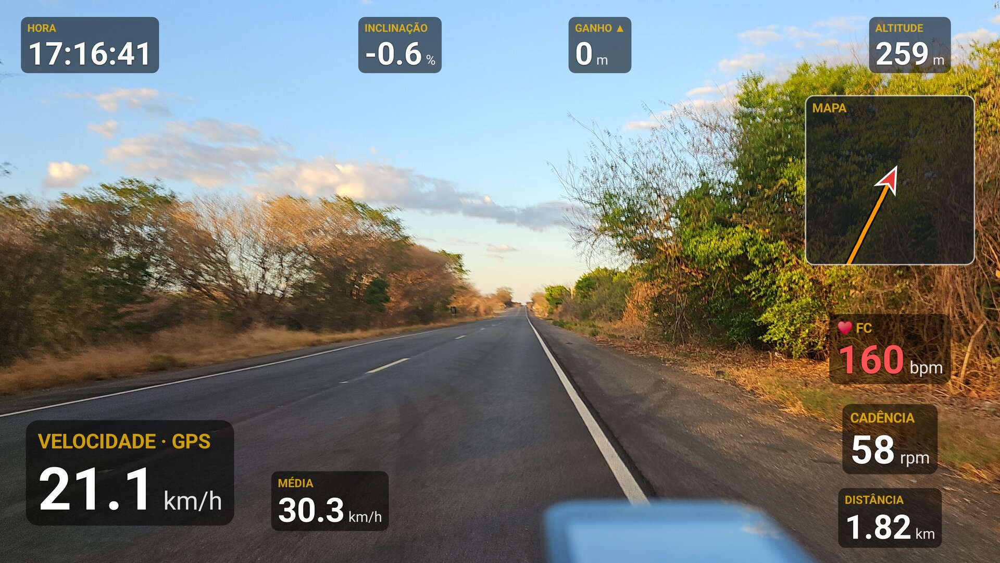

# BikeCam

App Android (Kotlin + Jetpack Compose + CameraX) que grava vídeo do guidão da bicicleta com um
OSD de telemetria queimado nos quadros (velocidade, média, FC, cadência, mini-mapa com a trilha,
distância, altitude, inclinação %, ganho de elevação, relógio) e salva a trilha bruta em GPX/FIT/JSONL.
Também desenha o mesmo HUD sobre vídeos de outras câmeras (GoPro, celular) usando a trilha de um
ciclocomputador (iGPSport, Garmin…).

## Exemplos

Quadro de um vídeo gravado pelo app, com o OSD queimado na imagem (hora, inclinação, ganho,
altitude, mini-mapa, FC, cadência, distância, velocidade GPS e média):



▶️ [Assistir exemplo no YouTube](https://www.youtube.com/watch?v=ljy5OcVNnTk)

## Instalação
Baixe o `BikeCam-*.apk` da [última release](https://github.com/rwagnervm/BikeCam/releases/latest)
e abra no celular (permita “instalar apps desconhecidos” para o navegador ou gerenciador de arquivos).
Requer Android 8.0+ em ARM 64 bits.

## Build
```bash
./gradlew assembleDebug          # APK em app/build/outputs/apk/debug/
./gradlew testDebugUnitTest      # parsers BLE, velocidade, GPX/TCX/FIT, elevação, sincronia, renderização, layout
adb install -r app/build/outputs/apk/debug/app-debug.apk
```
Requer Android 8.0+ (minSdk 26) em ARM 64 bits (`arm64-v8a`). Para testar sem sensores: Ajustes → "Dados simulados".

## Como funciona
- **OSD no vídeo**: `OverlayEffect` do CameraX aplicado só ao `VideoCapture`. A telemetria (5 Hz)
  vira um `Picture` em background; o callback por quadro só reproduz a última `Picture` pronta,
  então sensores lentos nunca derrubam quadros (`recording/OsdOverlay.kt`).
- **HUD na tela**: o preview é limpo e o mesmo `HudRenderer` desenha o HUD por cima em Compose.
- **Velocidade**: sensor BLE CSC se conectado e com dado recente; senão GPS (`telemetry/SpeedSelector.kt`).
- **BLE**: FC (0x180D) e CSC (0x1816), vários sensores ao mesmo tempo, reconexão com backoff
  (`telemetry/ble/BleSensorManager.kt`).
- **Foreground service** durante a gravação; a tela escurece após 5 s (toque devolve o brilho).
- **Mini-mapa** (`hud/HudRenderer.kt`, `hud/MapTiles.kt`, `hud/TrackPath.kt`): norte para cima,
  centrado na posição, ~800 m de lado, com a trilha desde o início da gravação e uma seta no rumo.
  Fundo com tiles do OpenStreetMap baixados em segundo plano e guardados em cache (até 150 MB);
  sem internet, mostra só a trilha. Pode ser desligado em Ajustes.
- **Inclinação e ganho de elevação** (`telemetry/ElevationEstimator.kt`): barômetro (altitude
  relativa) calibrado devagar pelo GPS; inclinação = Δaltitude/Δdistância em janela de 40 m,
  combinada por filtro complementar com a variação do pitch do acelerômetro (descontando dv/dt).
  Ganho com histerese de 2 m, só em movimento. Sem barômetro, usa GPS (janela 120 m, histerese 5 m).
- **Menu** (botão ☰, oculto durante a gravação): Sensores, Editar HUD, Vídeo externo com HUD e
  Ajustes, cada um com uma descrição e o estado atual, mais atalhos (áudio, botões de volume,
  confirmação, escurecer a tela).
- **Editor do HUD** (menu → "Editar HUD"): arrastar para mover, tocar para selecionar, −/+ para o tamanho,
  "Mostradores" para ligar/desligar. Um layout por orientação, salvo no DataStore.
- **Fotos durante a gravação**: "FOTO" (limpa, com GPS no EXIF) e "FOTO +HUD" (carimbada com o
  mesmo HudRenderer), na maior resolução 16:9 que o aparelho aceita junto com o vídeo, em modo de
  máxima qualidade (ou "disparo rápido", nos Ajustes) e JPEG 95. Se o aparelho não aceitar foto +
  vídeo na resolução escolhida, os botões somem.
- **Botões de volume** (tela de gravação): Vol+ inicia/para a gravação e Vol− tira foto (com HUD ou
  limpa, nos Ajustes), sem olhar a tela; controles remotos Bluetooth de selfie também funcionam.
  Confirmação por vibração e som: 1 longa = gravando, 2 curtas = parou, 1 curta = foto, 3 = erro.
  Com a opção ligada a tela não apaga na tela de gravação (o Android não entrega as teclas com ela
  apagada).
- **Estabilização** (Ajustes): desligada, "Vídeo (EIS)" ou "Vídeo + prévia" (modo
  `PREVIEW_STABILIZATION` do Android 13+); nas duas últimas o estabilizador óptico (OIS) é pedido
  explicitamente. Os Ajustes mostram o que o aparelho suporta e o modo em uso.
- **Modo economia** (botão "ECO"): tira a imagem da câmera da tela e mostra só números grandes em
  fundo preto; o vídeo continua sendo gravado com o OSD completo.
- **Gravação em partes** (Ajustes): divide o vídeo a cada 5/10/15/30 min. Cada parte é um MP4
  completo; a trilha GPX/FIT/JSONL continua única para o passeio inteiro.

## Vídeo externo com HUD (menu → "Vídeo externo com HUD")
Plano e decisões em [docs/PLANO-RENDER.md](docs/PLANO-RENDER.md).
- **Entrada**: vídeo(s) de qualquer câmera (capítulos da GoPro `GX01…`, `GX02…` são juntados) e a
  trilha do ciclocomputador em FIT, TCX ou GPX (`importer/`). Pontos esparsos (gravação
  “inteligente” a cada ~8 s) são interpolados quadro a quadro; intervalos > 20 s contam como parada
  (`render/RideTimeline.kt`).
- **Sincronia**: candidatos de hora de início lidos do MP4 (timecode `tmcd`, `creation_time` como
  UTC, hora local ou fim do vídeo, nome do arquivo — `render/VideoStartCandidates.kt`), ajuste fino
  de ±0,1 s a ±10 s com prévia do quadro + HUD, e atalho “digite a hora que aparece no quadro”.
- **Layout próprio** (“Editar layout do vídeo…”): editado sobre um quadro real do vídeo, com os
  dados da trilha; exporta/importa JSON. Mostradores só da renderização: potência, temperatura e
  perfil de elevação. Mostradores sem dado na trilha ficam escondidos; o mini-mapa mostra a rota
  inteira em cinza.
- **Renderização**: Media3 Transformer num foreground service (progresso e cancelar na
  notificação), recorte, 1080p/4K/original, H.264 ou HEVC, áudio original. Os tiles do mapa do
  trecho são baixados antes. No S23 Ultra, 2 min de GoPro 5.3K viram 1080p em ~55 s.
- **Limpeza do áudio** (opcional), com o modelo
  [MossFormer2_SE_48K](https://github.com/modelscope/ClearerVoice-Studio) (Apache-2.0) convertido para
  ONNX e rodando no celular (ONNX Runtime). “Remover vozes” tira a fala e mantém o som ambiente;
  “Remover ruído do vento” sozinho realça as vozes (ambiente −12 dB, sem o ronco grave); as duas
  juntas deixam só o ambiente sem o ronco. O modelo (120 MB) é baixado uma vez pelo app, da
  [release `modelo-audio-v1`](https://github.com/rwagnervm/BikeCam/releases/tag/modelo-audio-v1).
  O áudio é limpo numa passada própria antes do vídeo e leva mais ou menos a duração do trecho
  no S23 Ultra.

## Arquivos gerados
- `Movies/BikeCam/ride_AAAAMMDD_HHMMSS.mp4` (H.264, com OSD); em partes: `ride_…_02.mp4`, `_03`…
- `Pictures/BikeCam/bikecam_AAAAMMDD_HHMMSS.jpg` (limpa) e `…_hud.jpg` (carimbada)
- `Documents/BikeCam/ride_….gpx`, `.fit` (upload no Strava, com ganho de elevação) e `.jsonl`
  (telemetria a 5 Hz; `seg` = parte do vídeo e `v` = ms desde o início dessa parte, para
  re-renderizar overlay/mini-mapa)
- `Movies/BikeCam/render_AAAAMMDD_HHMMSS.mp4` (vídeo externo com HUD)

## Limitações conhecidas
- **H.265**: o CameraX 1.5 não expõe escolha de codec para vídeo SDR; ele só usa HEVC em HDR
  10-bit, que não combina com o OSD. O vídeo continua em H.264.
- Entre as partes da gravação segmentada fica uma lacuna de uma fração de segundo (o CameraX não
  troca de arquivo sem parar o encoder).
- A localização usa os serviços do Google Play (aparelhos sem eles ficam sem GPS).
